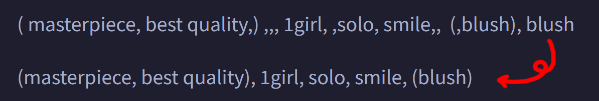
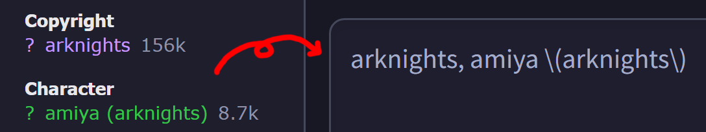

# SD Webui Prompt Format
This is an Extension for the [Automatic1111 Webui](https://github.com/AUTOMATIC1111/stable-diffusion-webui), which helps formatting prompts.

> Compatible with [Forge](https://github.com/lllyasviel/stable-diffusion-webui-forge)

<p align="center">
<br>
Sometimes, when you type too fast or copy prompts from all over the places, you end up with duplicated <b>spaces</b> and <b>commas</b>. This simple Extension helps removing them whenever you click <b>Generate</b>.
</p>

<br>

## Features
- [x] Works in both `txt2img` and `img2img`
- [x] Works in both `Positive` and `Negative`, as well as `Hires. fix` prompts
- [x] Remove extra **spaces** and **commas**
- [x] Fix misplaced **brackets**, **commas**, and **periods**
- [x] Enable `Remove Duplicates` to remove identical tags found in the prompts
  - Only checks within the same line
  - Only works for tag-based prompt, not sentence-based prompt
    - **e.g.** `1girl, solo, smile, 1girl` will become `1girl, solo, smile`
    - **e.g.** `a girl smiling, a girl standing` will not be changed
- [x] Enable `Remove Underscores` to replace `_` with `space`
- [x] Append a comma every line break
- [x] Toggle between auto formatting and manual formatting
  - In `Auto` mode: The process is ran whenever you click **Generate**
  - In `Manual` mode: The process is only ran when you click on the **Format** button
- [x] Press `Alt` + `Shift` + `F` to manually trigger formatting
- [x] Format the text pasted from clipboard
  - [x] Clean up unwanted texts when pasting from Booru sites
    - supports [danbooru](https://safebooru.donmai.us/) and [gelbooru](https://gelbooru.com/)

<p align="center"></p>

## Settings

> The settings are in the `Prompt Format` section under the <ins>System</ins> category

- [x] Enable / Disable the above Features
- [x] Exclude specific tags from `Remove Underscores`
- [x] Assign "[alias](#tag-alias)" that count as duplicates

> [!Tip]
> Click the `Reload` button to refresh the **Exclusion**, **Alias**, **LoRA** names, and **Embedding** names

> [!Note]
> Some Extensions *(**e.g.** [tagcomplete](https://github.com/DominikDoom/a1111-sd-webui-tagcomplete))* listen to the text editing event, meaning the formatting will cause them to be triggered. You can disable updating the actual prompts in the settings to prevent this.

## Tag Alias
- You can assign words to be automatically replaced with the specified tag
- As a result, they can then be removed during `Remove Duplicates` if needed
- The syntax is in the format of `tag:regex`
- The pattern for alias uses **Regular Expression**
- **Example:**
  ```
  1girl:girl|woman|lady
  ```
  - When you type `girl`, it will get converted into `1girl`
  - Which will get removed if the prompt already contains `1girl`
